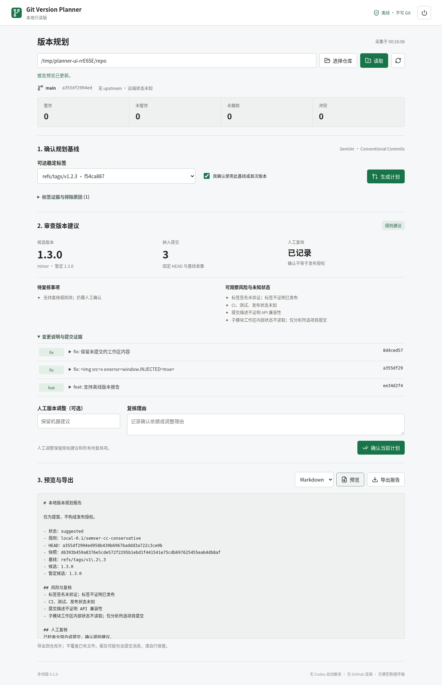

# Git Automatic Management

**Git Version Planner · 本地只读版 0.1.0**

将本地 Git 提交历史整理成可核对的 **下一版本建议、变更说明和风险清单**：选择仓库 → 确认基线 → 生成计划 → 复核与导出。

> 当前交付为 **Linux 本地独立工具**。名称中的“自动版本管理”不代表自动提交或发布。Codex 自动触发、GitHub 连接与直接远端规划尚未实现；本工具不提交、不打标签、不推送、不修改版本文件。



## 快速开始

### 获取项目

```bash
git clone https://github.com/tech-zerolei/git-automatic-management.git
cd git-automatic-management
```

这里的clone是手动获取本工具的安装步骤，运行中的规划器不会clone/fetch/push被分析的项目。

### 检查环境

需要Linux图形桌面和系统已有的 **Python 3、Git、Bubblewrap、Zenity、浏览器**。版本解析库和前端资源随包提供，启动无需pip/npm，无运行时下载。

```bash
/usr/bin/python3 --version
/usr/bin/git --version
/usr/bin/bwrap --version
command -v zenity
```

当前验证环境：Python **3.14.4**、Git **2.53.0**、Linux/GNOME。未承诺最低版本或全发行版兼容；Git须支持代码使用的参数。缺少组件时请用本发行版包管理器安装，程序不会自动安装或关闭隔离。

### 启动和桌面入口

```bash
./start.sh
```

可选的一次性入口安装：

```bash
./install.sh
```

之后双击桌面 **「Git 版本规划（本地版）」**。若提示不可信，右键“允许启动”。图标指向当前工程目录，移动目录后需处理旧入口并重新安装。

### 操作步骤

1. **选择仓库并读取**：查看分支、HEAD、变更与本地upstream信息。
2. **确认基线**：选择可达稳定标签并勾选确认；没有稳定标签则手动输入首次版本。
3. **生成计划**：查看候选版本、提交证据、breaking信号、待复核项与未知状态。
4. **人工复核**：输入理由，可调整版本；保留机器建议与冲突，不等于发布授权。
5. **预览/导出**：Markdown或JSON，保存到Git工作树和元数据目录之外，使用新文件名。
6. **退出**：右上角电源按钮；仅关闭窗口时后台在30分钟无请求后退出。

详见 **[使用指南与排障](docs/USER-GUIDE.md)**。

## 已实现功能

| 功能 | 当前行为 |
| --- | --- |
| 仓库选择 | 手选单一工作树；普通仓库、linked worktree；不扫描整机 |
| Git状态 | 分支/detached、HEAD/无提交、暂存/未暂存/未跟踪/冲突、upstream本地计数 |
| 手动刷新 | 重新读取；仓库变化使旧计划与人工确认失效 |
| 标签与基线 | 可达稳定SemVer、裸版本/小写v标签、显式确认、首次手填 |
| 版本建议 | fix/feat/breaking，稳定版和0.x分别映射 |
| 保守复核 | 非规范/未知/merge/revert、预发布/build、重复标签、占用版本、冲突 |
| 提交证据 | 固定HEAD与基线差集、完整消息/OID、破坏性变更正文 |
| 人工复核 | 理由、版本调整、快照/计划指纹，保留原建议与待复核项 |
| 报告 | Markdown/JSON预览与导出、旧指纹拒绝、不覆盖文件 |
| 中文界面 | 浏览器窗口、桌面入口、桌面/窄屏布局、系统文件选择器 |
| 读取保护 | 参数化白名单、封存配置、只读/网络隔离、过滤器拒绝、资源上限 |
| 本地会话 | 127.0.0.1、随机令牌、Host/Origin校验、仅内存、无模型或遥测 |

## 尚未实现与明确不做

| 分类 | 功能 | 当前说明 |
| --- | --- | --- |
| 原规划未实现 | Codex插件、工作开始/结束自动触发 | 独立窗口手动读取/刷新 |
| 原规划未实现 | 自动检测启停、暂停恢复、并发事件协调 | 没有宿主生命周期接入 |
| 原规划未实现 | GitHub PAT/SSH连接、直接远端完整图 | 无连接入口；本地使用不需要密钥 |
| 原规划未实现 | 系统凭据库、断开/删除、双认证通道 | 不接受或保存凭据 |
| 原规划未实现 | 策略配置、持久化设置、模型白名单投影 | 固定规则、不持久化、无模型通道 |
| 未完整验证 | 全平台、可访问性、性能支持矩阵 | 当前Linux实测；Windows/macOS未支持 |
| 本版限制 | LFS clean/process、浅克隆、include、部分克隆等 | 明确拒绝，不用不完整数据生成确定建议 |
| 原非目标 | 自动commit/tag/push、改版本文件、写回changelog、执行Release | 不提供；发布由维护者在工具外决定 |
| 后续候选 | 多包monorepo、预发布自动递增、CI/API分析、AI摘要 | 未实现，无交付日期承诺 |

**19条REQ和5条NFR逐项状态见 [功能与需求对照](docs/FEATURES.md)。** 本地子集测试不等于完整插件验收。

## 版本规则举例

以下是规则示例，不是实际API兼容性保证。

| 基线 | 新增提交信号 | 建议 |
| --- | --- | --- |
| 1.2.3 | 只有明确fix | 1.2.4 |
| 1.2.3 | 包含feat | 1.3.0 |
| 1.2.3 | feat!或BREAKING CHANGE | 2.0.0 |
| 0.4.2 | breaking或feat | 0.5.0 |
| 0.4.2 | fix | 0.4.3 |
| 稳定基线 | 没有新增提交 | 无需升级 |
| 无稳定基线 | 手动确认0.1.0 | 首次版本提案0.1.0 |
| 任意 | 未映射类型、merge/revert或其他歧义 | needs_review，不伪装确定候选 |

## 测试与交付状态

```bash
python3 -B -m unittest discover -s tests -v
```

实际基线：**38项通过**（27项本地产品＋11项前置工具回归）。浏览器E2E覆盖读取、基线、1.3.0建议、复核、预览、JSON导出、陈旧失效、布局和退出；被测页面外部请求0、页面错误0。

首轮独立审查发现1项P1、3项P2，已修复并增加回归；后续复审按用户要求停止，**不宣称复审通过**。

- [验收记录与修复](docs/implementation/LOCAL-ACCEPTANCE.md)
- [开发与复验](docs/DEVELOPMENT.md)
- [批准的本地版范围](docs/implementation/LOCAL-EDITION.md)
- [原始0.8-draft规划与历史](docs/specs/feat-001-git-version-planner/01-SPEC.md)
- [发布说明](CHANGELOG.md) · [安全边界](SECURITY.md)

## 重要限制

- 每次读取30秒、16MiB元数据/输出、5000提交和5000标签上限；超限拒绝，不把缺失当无变更。
- 不读取子模块内部；标签签名未验证、标签不证明发布；本地upstream不证明远端最新。
- 导出要求Linux O_TMPFILE支持；不支持时拒绝，不回退到不安全命名临时文件。不要在导出期间移动目录，检查不是阻止其他进程任意移动的原子锁。
- 无持久化缓存/设置；重启需重选重确认。导出报告可能包含提交信息，请妥善保管。
- 回环服务不是多用户网络服务器，请勿经反向代理对外暴露。

## 目录与许可

```text
start.sh / install.sh       启动与桌面入口
local_app/                 Python后端、中文界面、随包依赖
tests/                     合成仓库单测与浏览器E2E
tools/                     原完整插件前置实验/证据工具
docs/USER-GUIDE.md          使用、排障、升级卸载
docs/FEATURES.md            完整功能/需求状态
docs/DEVELOPMENT.md         开发、复验、发布边界
docs/specs/                原始规格与历史
docs/implementation/       实施、审查发现与真实证据
```

第三方许可见 [THIRD-PARTY.md](local_app/THIRD-PARTY.md)。主项目尚未指定许可证；公开源码不等于已授予某项开源许可。
